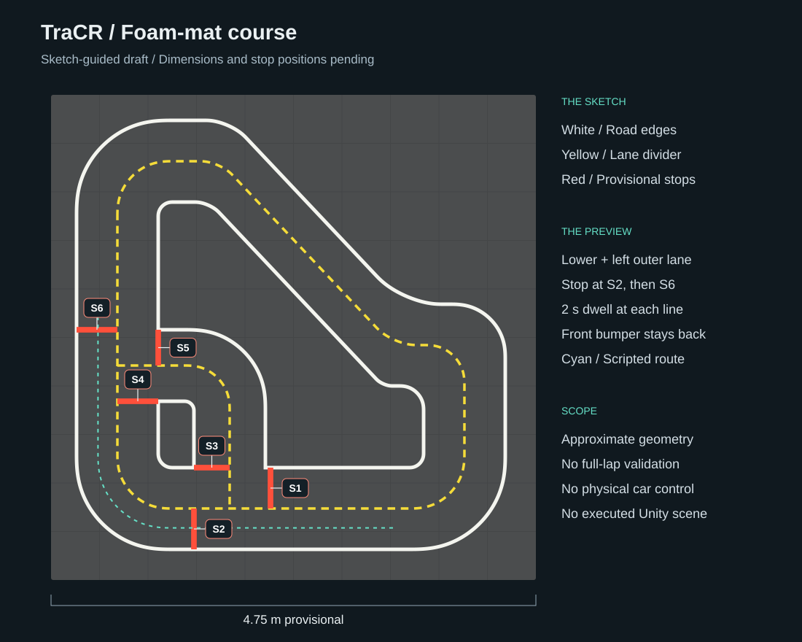

# TraCR-neoracer-demo

A NeoRacer V1 demonstration with **onboard video on the left and an AutoDRIVE view following measured vehicle poses on the right**. The intended deployment is the presenter's laptop on a local network, with a foam-mat road layout whose gray footprint was reported as approximately 4.5-5 m.

**This is a working software prototype. Physical NeoRacer and Unity integration have not been validated.** Both images in self-test mode are synthetic, not physical vehicle footage or AutoDRIVE renders. The earlier Nigel offline simulation is a separate result.

## What the display will look like


**Official NeoRacer model, scripted preview.** Both panels render the same NeoRacer geometry from the pinned AutoDRIVE source: a virtual onboard perspective on the left and a chase view on the right. This 25-second WebGL preview follows the outer lane of a sketch-guided road draft, braking before red stop lines S2 and S6 and waiting two seconds at each. It is **not physical video, an executed Unity scene or a live synchronization test**.

At the poster session, the **left panel will show the NeoRacer's physical camera**, and the **right panel will show AutoDRIVE following its measured pose** on a surveyed copy of the foam-board roads. Hardware integration, a measured map and camera calibration still need to be completed. The draft uses a provisional 4.75 m square footprint; the sketch and earlier oblique photo do not establish metric accuracy.

[Open the NeoRacer GIF](docs/media/neoracer-preview.gif) · [View the full-resolution still](docs/media/neoracer-preview.png) · [Model source and reproduction](docs/NEORACER_PREVIEW.md)



The latest hand-drawn sketch defines the road shape: a diagonal upper section, long left/right sides, a broad lower straight and a lower-left return branch around a small island. Six stop lines from the earlier field photo are provisionally placed near the branch junctions; the new sketch does not specify their positions. [Editable draft](configs/map.photo-v1.json) · [Rendered top view](docs/media/field-map-overview.png) · [Map details and Unity import](docs/PHOTO_MAP.md).

The preview grounds the model from its four tire groups and checks the whole vehicle footprint along the selected route. The animation demonstrates a **partial pass**, not a validated full lap or autonomous driving.

The earlier [Nigel / Tiny Town recorded Unity example](docs/PREVIEW.md) is retained separately. Nigel is a different vehicle; its geometry and experiment results are not presented as NeoRacer results.

## Current status

| Component | Status |
|---|---|
| Local dual-view display, timestamp pairing, stale indicators, fullscreen and mobile layout | Implemented; see [validation records](docs/VALIDATION.md) |
| Official NeoRacer geometry in a dual-view animation | Rendered with WebGL; sketch-guided draft, scripted lane motion and two stops; no Unity or hardware integration |
| Bounded video/pose buffers, one outstanding render request, acknowledgement validation | Implemented and covered by protocol tests |
| USB / RTSP / HTTP MJPEG camera adapter | Implemented; physical camera integration pending |
| Read-only ROS 2 camera and pose adapter | Implemented; JPEG decoding tested, ROS runtime unverified |
| Optional overhead AprilTag localization and calibration tools | Implemented; geometry unit tests pass, physical camera and detection performance unverified |
| AutoDRIVE CoSim follower and render acknowledgement component | C# source provided; not compiled or run in Unity |
| Sketch-guided map and shared curved tape geometry | Editable draft and overview completed; provisional 4.75 m square, survey pending |
| Unity map importer for ground, road blocks and sampled paint strips | C# source extended for curves, dashed lines and red stop lines; compilation and scene execution pending |
| Physical NeoRacer synchronization, measured latency and spatial error | **Unverified; requires field hardware** |
| Autonomous driving control, SLAM and validation of new vehicle dynamics | Outside the current implementation |

## Run without hardware

Use Python 3.10 or 3.11 on the demonstration laptop. Local automated validation used Linux and Python 3.9; Windows and macOS have not been tested on physical machines. The frontend requires no CDN, Node installation or cloud service.

```bash
python -m venv .venv
# Linux/macOS
source .venv/bin/activate
# On Windows PowerShell, use: .venv\Scripts\Activate.ps1
python -m pip install -e ".[camera,test]"
tracr-demo --self-test
```

Open <http://127.0.0.1:8080>. The display continuously identifies this mode as **SYNTHETIC SELF-TEST**. Stop the service with Ctrl+C.

For live inputs:

```bash
tracr-demo --config configs/demo.json
```

Without physical data, the display shows a waiting state. It does not automatically substitute synthetic images or recorded footage.

## Connect field equipment

1. **Camera:** start an adapter in a second terminal. For a USB camera, use `python adapters/camera.py --source 0`. For an existing RTSP stream, use `python adapters/camera.py --source rtsp://CAMERA_HOST/STREAM`, replacing the placeholder with the actual address. Verify encoding, drivers and connectivity on site.
2. **Localization:** provide measured position and heading in map coordinates. Use `adapters/ros2_readonly.py` with an existing reliable ROS 2 localizer, or `adapters/apriltag.py` if an overhead camera can be installed. Onboard video alone does not automatically provide absolute pose. See [hardware integration and calibration](docs/CALIBRATION.md).
3. **AutoDRIVE:** follow [Unity integration](docs/UNITY.md) to fetch the pinned source and configure the NeoRacer prefab, camera, scene and `TraCRPoseFollower`. Run the Editor or a built player on the laptop.
4. **Map:** follow the [foam-board map workflow](docs/MAP_WORKFLOW.md) to survey the roads and build the matching Unity scene. Start with the [sketch-guided draft](docs/PHOTO_MAP.md), refine it from measurements, and import its generated geometry. The importer supports straight road blocks and sampled tape strips, including curves, yellow dashes and red stop lines. C# execution remains unverified.
5. **Rehearsal:** follow the [field runbook](docs/RUNBOOK.md) to verify straight driving, turns, recovery after disconnection, spatial alignment and latency on both views.

The camera, localizer and Unity can start independently. A paired display requires timestamps within tolerance and a Unity acknowledgement matching the correct video and pose IDs. See the [protocol](docs/PROTOCOL.md).

## Repository layout

```text
tracr_demo/        Python service and browser interface without external resources
adapters/          Camera, read-only ROS 2 and overhead AprilTag adapters
unity/             AutoDRIVE follower, render acknowledgement and road importer
configs/           Configuration files and uncalibrated examples
scripts/           Calibration, metrics, upstream fetching and Slurm validation
tests/            Protocol, timestamp, disconnection and coordinate tests
docs/             Deployment, integration, validation, provenance and publishing
upstream.lock.json Pinned upstream source and Unity versions
```

Run `python -m pytest -q` to check software behavior. Browser checks are documented in `docs/VALIDATION.md`. `requirements-tested-linux-py39.txt` records the exact dependencies used for local Linux validation. Install from `pyproject.toml` and repeat acceptance checks on other platforms.

## Gilbreth and GitHub

Substantial computation and browser rendering on Gilbreth must run through Slurm. Prefer `sukkusur / a100-40gb / normal`; use `a30 / standby` only when the group allocation is occupied or committed to queued work. Full demonstrations must not use A10. `scripts/submit_validation.sh` checks group allocations before each submission and stops for review if A30 entitlement changes. See the [GPU constraints](docs/GILBRETH.md). These scheduling checks do not establish Unity Vulkan compatibility on A100/A30.

The repository excludes Unity binaries, large upstream assets, physical vehicle recordings, network credentials and fabricated hardware results. See [publishing and license status](docs/PUBLISH.md) and [provenance](docs/PROVENANCE.md). All repository content must be written in English.
