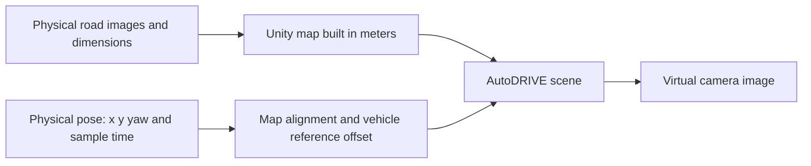

# Reconstructing the foam-board roads in AutoDRIVE

Roads assembled from foam board and tape can be reproduced in a custom Unity scene. AutoDRIVE supplies the vehicle and simulation framework. This project does not automatically reconstruct the full venue from onboard video.

The latest user-supplied hand-drawn sketch now defines the road topology: a diagonal upper section, main loop and lower-left return branch with a small island. It supersedes the earlier oblique-photo interpretation. Six red stop lines from the field photo are retained at provisional branch-junction positions; the new sketch does not locate them. The reported gray footprint is approximately 4.5-5 m, with its exact aspect ratio unconfirmed. The [sketch-guided draft](PHOTO_MAP.md) provisionally uses 4.75 m x 4.75 m and remains `measured=false`.

`configs/map.photo-v1.json` is the editable draft. Its generated `.geometry.json` shares the same sampled tape strips between WebGL and the updated Unity importer. Curved white edges, dashed yellow dividers and red stop lines are included. The separate `configs/map.example.json` remains an illustrative rectangular loop. The C# importer has not been compiled or run in Unity; it does not add autonomous stopping logic or detailed obstacle/sensor models.

## Start with accurate dimensions and simple geometry

For the poster demonstration, prioritize matching road layout, vehicle position and heading. Foam texture, tape edges and lighting can be refined later. When the physical vehicle turns at an intersection, the virtual vehicle should turn at the corresponding intersection in the same map coordinates.

| Physical information | Simulation representation |
|---|---|
| Venue footprint | Ground with the measured length and width; project distance units are meters |
| Straight roads and widths | Surveyed road segments with edges placed at the actual width |
| Curves and intersections | Curves or planar meshes from surveyed edge/centerline points; the illustrative right-angle corners do not define a drivable curved road |
| Tape markings, stop lines and crosswalks | Road textures or separate planar geometry using measured positions and widths |
| Raised foam boards and obstacles | Simple boxes/models with measured dimensions and height; collisions or lidar simulation also require suitable colliders and sensor settings |
| Onboard camera | For two forward-facing views, align virtual camera position, orientation, field of view and resolution with the physical camera |

Following measured poses is state visualization. A vehicle that appears to follow the road does not establish validated vehicle dynamics or independent autonomous driving.

## Two construction approaches

**Build from measurements:** derive road coordinates from an overhead image or sketch, prepare a dimensioned plan, and create road surfaces and simple structures in Unity. Geometry changes and map versions remain explicit, making this suitable for continued development. The importer now accepts sampled curved paint strips from the photo draft, while accurate geometry still requires measurements.

**Use a rectified overhead image as a ground texture:** for a mostly flat layout, take a clear overhead image without a vehicle obscuring the roads, correct lens distortion and perspective, and scale it using measured control points. Place it on a ground surface of the correct dimensions, then add simple models for raised boundaries. This retains the appearance of tape markings, but the image has no height, collision geometry or lidar surfaces. The repository does not yet implement this texture-import workflow. An oblique phone photo is not automatically an accurate map, and photographs do not replace localization or clock synchronization.

For the first demonstration, prefer a simple scene built to measured dimensions. A good overhead image can serve as a modeling reference or a later texture.

## Required survey material

1. An overhead image showing all roads, or a clear hand-drawn plan. Aim as close to vertically downward as possible and include a tape measure or marked known distances.
2. Actual footprint length and width, road widths, straight lengths, intersection centers, and inner/outer curve edges or sampled points. For repeated foam-board modules, provide the module dimensions and assembly layout.
3. A fixed origin, such as a footprint corner, with +x and +y marked. Keep at least three non-collinear reference points that can be measured again.
4. Positions and heights of raised boards, ramps or obstacles. Identify whether each marking denotes a road edge or lane centerline.
5. For matching forward-facing views, provide camera height above the ground, position relative to the vehicle reference point, pitch, and available intrinsics or field of view.

Refine the existing photo draft into a separate surveyed configuration when dimensions are available. Keep `measured=false` until the survey has been checked. Changing that flag alone does not turn `map.example.json` into a measured map.

## Use one coordinate system for the map and vehicle

With a shared origin and axis directions, place the car near the origin, midway along a straight, at an intersection and at a distant curve. Compare physical and virtual reference-point positions and headings, recording errors at independent check points. Then drive slowly to check dynamic alignment. A matching map addresses spatial geometry; continuous following still requires map localization and calibrated video/pose timestamps.

See the [official Unity camera documentation](https://docs.unity3d.com/2022.3/Documentation/Manual/class-Camera.html) for projection, field-of-view and physical-camera parameters. Project integration is covered in [UNITY.md](UNITY.md), with localization and coordinate calibration in [CALIBRATION.md](CALIBRATION.md).
