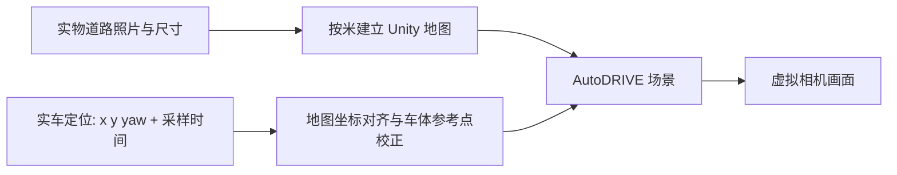

# 把泡沫板道路变成 AutoDRIVE 场景

真实道路由泡沫板和胶带手工拼接，并不妨碍在模拟端复现。需要把它当作一张自定义 Unity 场景来建模。AutoDRIVE 提供车辆和仿真框架；本项目不会自动从车载视频恢复整张场地。

当前仅知道场地约 5 m × 5 m，还没有实际道路尺寸图。`configs/map.example.json` 是示意矩形环路，**不是你们的地图**。`TraCRMapBuilder.cs` 当前只把直线道路段导入为矩形路面块；没有自动生成平滑弯道、标线、泡沫板边界、贴图或碰撞细节，也未经过 Unity 编译运行验证。

## 第一版建议做尺寸准确的简化场景

对 poster 展示，先保证道路布局、车辆位置和方向对应。泡沫板纹理、胶带毛边和灯光可以后补。实车在某个路口转弯时，虚拟车应该在同一地图坐标的同一路口转弯。

| 实物信息 | 模拟端处理 |
|---|---|
| 场地外框 | 按实测长宽建立地面，项目约定距离单位为米 |
| 直路与路宽 | 导入测量后的道路段；左右路缘按实际宽度布置 |
| 弯道和路口 | 用测量的边缘/中心线点制作曲线或平面网格，避免把示例直角拐弯当作真实可行驶曲线 |
| 胶带标线、停止线、斑马线 | 加到路面纹理或独立平面几何中；位置和宽度以测量为准 |
| 立起的泡沫板、路障 | 添加对应尺寸和高度的简单立方体/模型；需要模拟碰撞或雷达时另配碰撞体和传感器设置 |
| 车载相机 | 若两侧都展示前视图，核验虚拟相机相对车体的位置、朝向、视场角与分辨率 |

虚拟车跟随实测位姿属于状态映射。即使看起来沿道路行驶，也不能由此证明车辆动力学或独立自动驾驶算法已验证。

## 两种地图制作方式

**按尺寸建模**：从俯视图/手绘图量出道路坐标，制作带尺寸的道路图，再在 Unity 中生成路面和简单结构。几何修改和地图版本管理比较明确，适合后续持续开发。现有 JSON 导入器是这一方式的基础，复杂弯道需要继续扩展。

**校正俯视照片作为地面贴图**：如果道路基本平坦，可使用清晰、无车遮挡的俯视照片，经镜头与透视校正、按实测控制点定尺度后，铺到对应尺寸的地面上，再为立体边界添加简单模型。这能保留胶带道路外观，但照片本身没有高度、碰撞体或雷达表面。当前仓库尚未实现这个贴图导入流程。单张倾斜手机照片不能直接视为准确的地图；照片也不能替代定位和时钟同步。

对第一轮演示，优先按尺寸建立简化场景；如果已有质量好的顶视照片，可以把它作为建模底图或后续纹理。

## 需要提供的测量材料

1. 一张能看清全部道路的俯视照片，或清楚的手绘平面图。照片尽量接近垂直俯拍；周围放卷尺或标记已知距离。
2. 实际外框长宽。至少补充各段路宽、直路长度、路口中心位置、弯道内外缘/若干采样点。若是重复泡沫板模块，提供单块尺寸和拼接排列图。
3. 选定一个固定原点，例如外框角点，标明 +x、+y，并保留至少三个不共线、可复测的场地参考点。
4. 如果有立起的板、坡道或路障，补充高度和位置。说明标线是道路边界还是车道中心线。
5. 若要求前视画面对照，提供车载相机距地高度、相对车体参考点的位置、俯仰角，以及可获取的内参或视场角。

照片/尺寸取得后，制作并保存实际地图配置，保持 `measured=false`，直到测量和核对完成。`map.example.json` 的矩形环路不能仅修改标志就当作实际地图。

## 地图和车辆必须用同一个坐标系

在相同原点和方向下，把车分别放在原点附近、直路中部、路口和远端弯道，比较真实/虚拟参考点的位置与朝向，记录独立检查点的误差。再低速行驶检查动态对应。地图对得上只解决空间模型问题；持续跟随仍需要地图定位，视频和位姿的采样时间也要校准。

Unity 相机的投影、视场角和物理相机参数说明见 [官方相机文档](https://docs.unity3d.com/2022.3/Documentation/Manual/class-Camera.html)。本项目集成步骤见 [UNITY.md](UNITY.md)，定位与坐标标定见 [CALIBRATION.md](CALIBRATION.md)。
