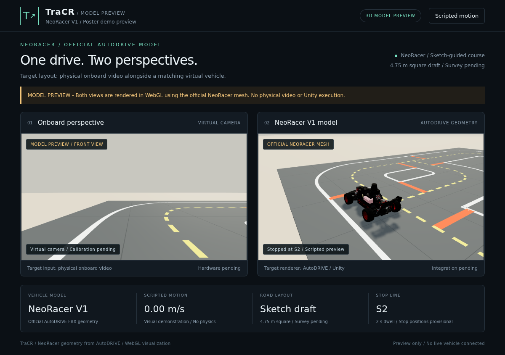

# NeoRacer model preview



[Play the 24-second GIF](media/neoracer-preview.gif) · [Generation manifest](media/neoracer-preview.json) · [Media checks](media/neoracer-validation.json)

This preview uses the **official NeoRacer 3D geometry from AutoDRIVE**, replacing the visually different Nigel vehicle in the main README illustration. Both the virtual front camera and chase camera view the same animated NeoRacer and sketch-guided foam-mat road draft.

The renderer is Three.js in Chromium WebGL. **This is not an executed AutoDRIVE/Unity scene, a vehicle dynamics simulation, physical footage or a live synchronization test.** The route is scripted, and camera placement is illustrative. The [sketch-guided map](PHOTO_MAP.md) approximates the supplied layout at a provisional 4.75 m square scale; it is not a measured reconstruction. The frontend's normal live and synthetic self-test modes are unchanged.

The browser and updated Unity map importer consume the same sampled paint strips. The browser rendering has been exercised; the C# importer has not been compiled or run in Unity. The animation covers a partial clockwise outer-lane pass, with two-second stops at S2 and S6. It does not establish that every lane or turn accommodates the vehicle.

## Model source and conversion

- Repository: [Tinker-Twins/AutoDRIVE](https://github.com/Tinker-Twins/AutoDRIVE/tree/75b7df5216524a3c6b3150d698139190c6c44f8f).
- Geometry: [NeoRacer.fbx](https://github.com/Tinker-Twins/AutoDRIVE/blob/75b7df5216524a3c6b3150d698139190c6c44f8f/Assets/Models/Vehicle/NeoRacer/NeoRacer.fbx), 18,129,712 bytes, Git blob `4bec75b5320467004ac3ae1c5141f378deab282b`.
- The corresponding [NeoRacer prefab](https://github.com/Tinker-Twins/AutoDRIVE/blob/75b7df5216524a3c6b3150d698139190c6c44f8f/Assets/Prefabs/NeoRacer/NeoRacer.prefab) remains the integration target for Unity. Loading its FBX in a browser does not compile or run that prefab's controllers, sensors or other components.
- Unity material remappings supply the base colors, metallic values and smoothness. These are approximated with WebGL materials; Unity HDRP shaders are not reproduced exactly.
- The FBX uses inches (`UnitScaleFactor = 2.54` centimeters per source unit). The renderer reads this binary property directly and converts to meters. It identifies the front and rear axle geometry, rotates their rear-to-front direction to the preview's +Z axis and verifies the alignment. The body is centered horizontally and grounded from the transformed mesh vertices of the four named tire groups, with no additional body lift. Using actual vertices avoids an approximately 14.3 mm gap left by the earlier rotated bounding-box approximation. The actual tire bottoms vary by about 0.044 mm, checked against a 2 mm tolerance. No hand-drawn vehicle substitutes, image-generation replacements or Nigel meshes are used.
- Cameras, lighting, road geometry and scripted motion are presentation settings, not calibrated NeoRacer measurements or a demonstration of its dynamics.

`configs/preview-assets.lock.json` records each upstream URL and SHA-256. Model files and third-party JavaScript are downloaded to the ignored `upstream/preview-assets/` directory instead of being bundled into the repository. The respective [AutoDRIVE](third-party/AutoDRIVE-LICENSE.txt) and [Three.js](third-party/threejs-LICENSE.txt) notices are preserved.

## Reproduce

With Python, Playwright/Chromium and FFmpeg installed:

```bash
python scripts/build_photo_map.py
python scripts/fetch_neoracer_preview.py
python -m pip install playwright Pillow
python -m playwright install chromium
python scripts/render_neoracer_preview.py --probe
python scripts/render_neoracer_preview.py --ffmpeg /path/to/ffmpeg
python scripts/check_neoracer_preview.py
```

The probe saves four model inspection angles, a map plan, a footprint/stop/contact check report and a mesh/material report in `runtime/neoracer-preview/`. The full renderer writes `docs/media/neoracer-preview.gif`, `docs/media/neoracer-preview.png` and a provenance manifest. It also exports a top-down map image. Both use the existing frontend HTML/CSS, with recording-only labels applied in the browser. The live application JavaScript is not executed.

On Gilbreth, run both rendering commands inside Slurm, following [the allocation policy](GILBRETH.md). Check `slist` immediately before submission; prefer `sukkusur / a100-40gb / normal`, and use `a30 / standby` when the group A100 allocation is occupied or committed to queued work and A30 entitlement remains absent. Do not use A10. Chromium uses SwiftShader for this geometry preview; its success does not establish native Unity Vulkan compatibility on either GPU. The earlier photo-map inspection succeeded on A100 node `gilbreth-n014`; revision-2 rendering exercised A100 `gilbreth-n008` and A30 `gilbreth-b009`; browser startup failed on n002/n011, with the root cause unresolved. Use `--probe` to check an allocated node first. A node preference never overrides the permitted-partition policy.

`scripts/render_neoracer_preview.sbatch` runs the full capture and media checks with four CPUs, 12 GB, one GPU and a twelve-minute limit (SwiftShader speed varies by node). Submit it from the repository root after checking the allocation. Set `TRACR_BROWSER_PYTHON`, `TRACR_VALIDATION_PYTHON`, `PLAYWRIGHT_BROWSERS_PATH` and `TRACR_FFMPEG` when reusing separate existing environments. The validation Python requires Pillow. Use `--partition=a30 --qos=standby` on `sbatch` only when the allocation rule requires the fallback.

## What still needs to happen for the poster

Import the actual NeoRacer prefab into the laptop's AutoDRIVE scene, build the surveyed road layout, calibrate the physical/virtual coordinate transform and camera view, then connect the camera/localizer and Unity acknowledgement protocol. Follow [Unity integration](UNITY.md), [map reconstruction](MAP_WORKFLOW.md) and the [field runbook](RUNBOOK.md).

The earlier [Nigel/Tiny Town animation](PREVIEW.md) is retained as a separate recorded Unity simulation example. Its controller results and error measurements do not transfer to this NeoRacer geometry preview.
