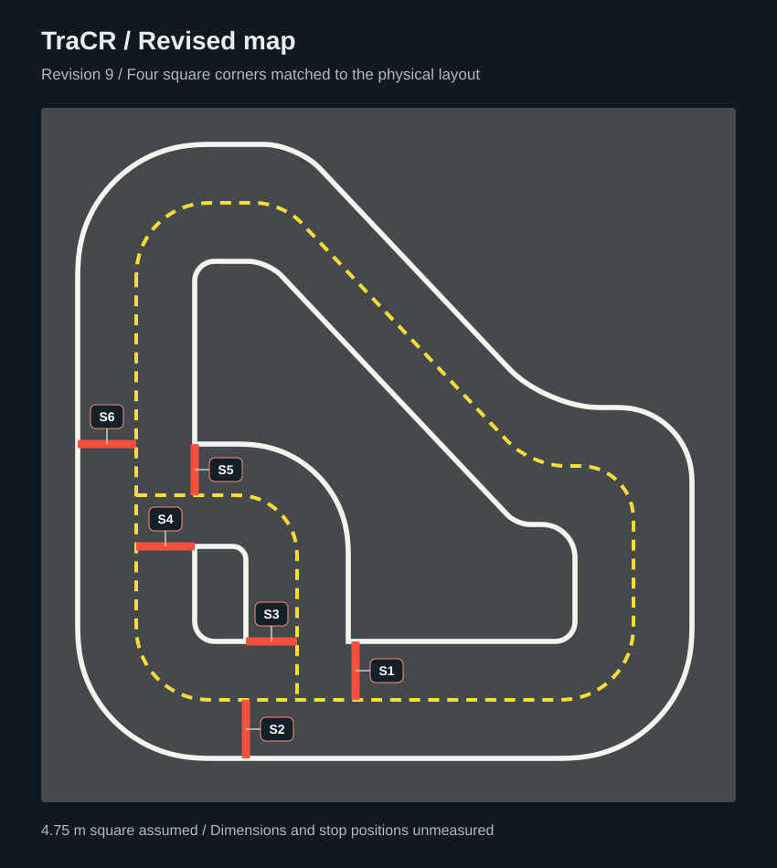
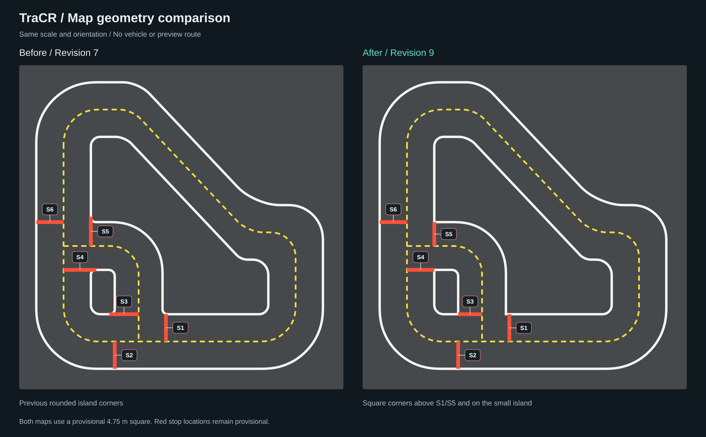

# Sketch-guided foam-mat course

Revision 9 retains the revision-8 road geometry and reverses the preview for right-hand traffic. The map refines the user's hand-drawn road sketch supplied on 2026-10-23. It preserves the diagonal upper section, long left and right sides, broad lower straight, large central island and **lower-left return branch** around a smaller island. Exact line segments replace bowed straights. Rounded bends use quintic Bezier fillets with continuous tangent direction and curvature. Four user-confirmed physical corners remain exact right angles: above S1 and S5, and at the small island upper-left and lower-right. The reference photo supplies the flat mat and white, yellow and red tape appearance. The upper-right shoulder is 0.55 m lower than revision 3, lengthening the straight diagonal by about 0.366 m and shortening each right vertical by 0.55 m at the provisional scale. Revision 7 contributes the final 0.20 m shortening; the outer right straight is now 0.90 m long, compared with 1.10 m in revision 6.

The sketch does not show stop lines. The six red stop lines retain IDs S1-S6. Revision 6 applies the user-specified small-island alignments for S2, S3 and S5 and snaps their endpoints to the road boundaries. S1, S4 and S6 keep the alignment axes established in revision 5. Revision 8 preserves stop alignment axes and reattaches the island-side endpoints on S1/S3/S4/S5 to the square boundaries. Absolute physical positions remain unmeasured. This is a manual interpretation of the sketch, not calibrated photogrammetry or a metric survey. The existing `map.photo-v1.json` filename remains the editable entry point; its `revision` field is now 9.

The reported gray footprint is approximately 4.5-5 m. Pending confirmation of both dimensions, the draft assumes **4.75 m x 4.75 m**. Lane widths, curve radii and stop-line positions are approximate. `measured` remains `false`. The classroom photograph is not included in the repository.

[Map only](media/field-map-only.png) · [Shape without stop lines](media/field-map-only-shape.png) · [Before/after comparison](media/field-map-comparison.png) · [Top-down WebGL rendering](media/field-map-overview.png)

## Stop-line identifiers

S1-S6 are stable IDs from the editable JSON, now displayed beside each red line with a leader. Labels do not cover the tape. Revision 6 moves S2 left to the small island right-side extension (x=1.40), moves S3 into the lane between that island and the branch divider at the island bottom height (y=3.65), and moves S5 left to the island left-side extension (x=1.05). Plan coordinates increase to the right (+x) and downward (+y).

| ID | Location in the plan | Endpoints (x, y), provisional meters |
| --- | --- | --- |
| S1 | Bottom inner lane | (2.15, 3.65) to (2.15, 4.05) |
| S2 | Bottom outer lane, aligned with small island right side | (1.40, 4.05) to (1.40, 4.45) |
| S3 | Between small island and branch divider, level with island bottom | (1.40, 3.65) to (1.75, 3.65) |
| S4 | Level with the small island top, meeting its upper-left corner | (1.05, 3.00) to (0.65, 3.00) |
| S5 | Upper branch entrance, aligned with small island left side | (1.05, 2.30) to (1.05, 2.65) |
| S6 | Left outer lane, retaining revision-5 height | (0.25, 2.30) to (0.65, 2.30) |

The four square vertices use `corner_cut_m=0`: central island (2.10, 3.65) above S1 and (1.05, 2.30) above S5; small island (1.05, 3.00) upper-left and (1.40, 3.65) lower-right. S1 meets the flat lower edge at y=3.65. S3, S4 and S5 meet the square corners directly. Their alignment axes remain unchanged; S2 and S6 retain their full endpoint pairs.

Edit a stop's two `points` under its `id` in `markings`. Keep the ID stable so `preview_route.stop_ids` continues to refer to the intended line, then regenerate the map and rerun connectivity and route checks. The unlabelled shape view omits stops entirely. The comparison now uses the archived revision-7 geometry as its immediate baseline.

## Where the map lives

| File | Purpose |
| --- | --- |
| [`configs/map.photo-v1.json`](../configs/map.photo-v1.json) | Editable vertices, corner cut distances, paint widths, stops and route |
| [`scripts/map_curves.py`](../scripts/map_curves.py) | Exact lines, sharp vertices and curvature-continuous fillets |
| [`scripts/build_photo_map.py`](../scripts/build_photo_map.py) | Generates shared sampled geometry and the annotated plan |
| [`configs/map.photo-v1.geometry.json`](../configs/map.photo-v1.geometry.json) | Generated browser/Unity input; do not edit by hand |
| [`scripts/build_map_views.py`](../scripts/build_map_views.py) | Standalone map and comparison SVGs, without a vehicle or route |

The previous generator passed all vertices through a uniform Catmull-Rom spline, causing straight edges to bow near turns and the small island to bulge. Source `points` now specify intersections of the incident straight lines. Each positive `corner_cut_m` trims both adjacent lines by that distance; it is **not a circular radius**. A zero cut preserves the exact intersection as an intentional sharp corner, including a closed seam. Six Bezier controls define each trimmed corner, with the first and last three equally spaced and collinear. Endpoint curvature is zero, matching the incident straight, and tangent direction is continuous. This continuity applies to rounded joins; the four declared square corners intentionally change tangent direction abruptly. Segment parameter speeds are not claimed to be equal.

For example, the outer left, right and bottom straights are exactly `x=0.25`, `x=4.45` and `y=4.45` m. The main divider uses `x=0.65`, `x=4.05` and `y=4.05` m. Lower corners share aligned tangent locations across the road. Straight portions of the main road are nominally 0.8 m wide, and the return branch is 0.7 m wide; bends are individually fitted to the sketch, rather than exact constant-width offsets. All widths remain design assumptions. Curves are exported with a maximum chord length of 8 mm (plus coordinate rounding); no consumer applies a second smoothing pass.

## Edit and import

1. Edit the meter-valued tangent-intersection vertices, `corner_cut_m`, paint widths, stop-line endpoints and footprint in `configs/map.photo-v1.json`. There must be one cut distance per vertex; the sum of adjacent cuts must be smaller than their edge length. Open endpoints have zero cuts. Changing only `width_m` or `height_m` changes the mat size, **not** the coordinates; rescale or remeasure the points and cuts as well.
2. Run `python scripts/build_photo_map.py`, `python scripts/check_photo_map.py` and `python scripts/build_map_views.py` to regenerate shared geometry, the annotated plan and standalone SVGs. The generated geometry records its source SHA-256. Run `python -m pytest -q tests/test_map_curves.py` to check straightness, smooth joins, explicit sharp vertices and sampling. With Playwright/Chromium installed, `python scripts/render_map_views.py` exports PNGs without loading the vehicle; on Gilbreth run browser rendering in an allowed Slurm allocation.
3. To reproduce the browser preview, follow [the rendering instructions](NEORACER_PREVIEW.md). Rendering and encoding must run in an allowed Slurm allocation on Gilbreth.
4. In the AutoDRIVE Unity project, use `TraCR / Import road layout JSON` and select the generated `.geometry.json`, not the control-point file. The importer creates the flat mat and sampled curved tape strips. The C# changes remain uncompiled and unexecuted in this environment.

The map origin is the far-left mat corner in this plan; +x points right and +y points toward the near edge. Units are meters. The Unity importer uses `(-y, height, x)`, consistent with the pose bridge. The WebGL preview centers and rotates this plan for presentation. Grid seams are illustrative and do not establish actual foam-tile dimensions.

The sampled strips are shared across SVG, WebGL and Unity. Yellow dashes are split by arc length before export, so the importer does not invent a different dash pattern. SVG, WebGL and the Unity importer use miter joins to preserve square paint corners and closed seams. Stop lines are flat red geometry with IDs S1-S6. Importing them does **not** implement stop detection or vehicle control.

## Vehicle placement and scripted stops

The official NeoRacer mesh uses its original source units and axle-derived forward direction. Ground placement uses the transformed mesh vertices of the four named tire groups. The earlier approximate bounding boxes extended about 14.3 mm below the actual tire surfaces; revision 2 corrects this remaining gap as well as retaining removal of the previous 12 mm body lift. The actual tire bottoms vary by about 0.044 mm; the preview checks a 2 mm contact tolerance and reduces shadow bias.

The selected route is a **partial counterclockwise pass in the outer lane**, down the left side, around the lower-left turn and right along the lower straight. The yellow divider stays on the driver's left, so the vehicle travels in the right-hand lane. Revision 9 reverses the earlier route and moves its starting point from y=2.05 to y=1.75 to leave front-bumper clearance before the first stop at S6; road and stop coordinates are unchanged. The checker samples the complete CAD bounding rectangle at intervals no greater than 1 cm, requiring it to remain inside the outer white boundary and outside the yellow divider, with clearance from every white/yellow marking. At each sample it also verifies that the nearest main-divider point is on the driver's left. Invalid stop order or insufficient approach distance fails before capture. This checks the rendered footprint; it does not validate a steering model or the whole course.

The animation accelerates and brakes along that route, stopping with the front bumper before **S6**, waiting two seconds, and repeating at **S2**. The nominal bumper gap is 7 cm. The stopping solver uses the rotated full-body footprint and tape width, including the curved approach to S2, so reversing the route does not reduce this gap. The other four stop lines belong to lanes/branches not traversed in this preview. The final hold is labeled as a completed pass before the GIF restarts.

For live synchronization, measured vehicle poses must drive the virtual car. Do not make the virtual car stop independently while the physical car continues. This preview's stopping schedule is not connected to the physical vehicle or the live service.

## Before the poster session

Measure the mat's two dimensions, lane widths, stop-line endpoints and several independent road reference points. An overhead image will improve the contours. Refine the map, rerun the footprint checks for the intended route, import it into Unity, and verify the real vehicle reference point and camera calibration at several locations. A measured map and successful laptop rehearsal are still required.
