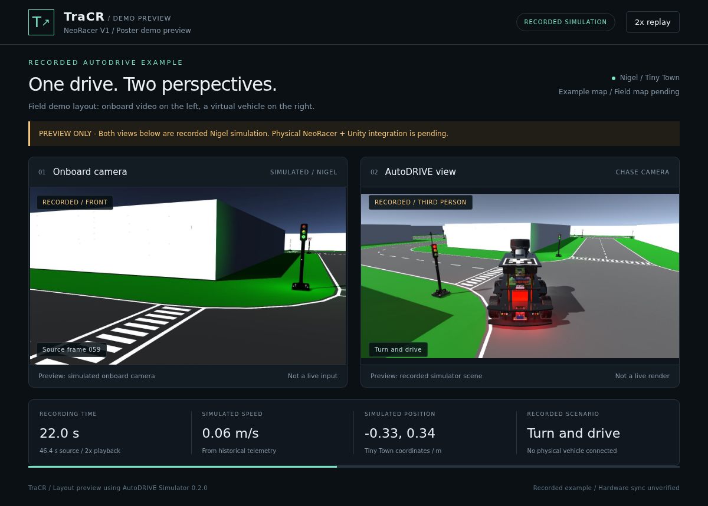

# README animation



[Play the looping GIF](media/autodrive-preview.gif). The preview uses the same HTML and CSS as the display service, with compact spacing and explicit recorded-example labels. It is a documentation capture, not an additional live mode. Running `tracr-demo --self-test` still produces labeled synthetic images; starting the service without inputs still waits for hardware.

## Reading the preview

| Element | Included example | Intended poster session |
|---|---|---|
| Left panel | Recorded Nigel simulated front camera | Physical NeoRacer onboard video |
| Right panel | Recorded Nigel third-person simulator view | AutoDRIVE NeoRacer rendered after applying measured physical pose |
| Road layout | AutoDRIVE Tiny Town | Surveyed replica of the approximately 5 m x 5 m foam-board roads |
| Metrics | Historical simulation time, speed, position and scenario phase | Live pairing diagnostics, measured map position and connection status |
| Data transport | Local files read by the documentation renderer | Camera/localizer adapters and the Unity acknowledgement protocol |

The animation shows an approach, a red-light wait, a turn and a stop at the goal. It contains **no physical vehicle footage**, no new Unity execution and no latency measurements. Corresponding front/scene files share a recorded source index; this does not establish physical exposure synchronization or test the live pairing protocol.

## Source and timing

- Source: the original Nigel / AutoDRIVE Simulator 0.2.0 / Tiny Town result in `/scratch/gilbreth/zjcai/autodrive-demo/outputs/final_demo/`.
- Input: `telemetry.jsonl` and each row's `frames/NNNNN_front.jpg` and `frames/NNNNN_scene.jpg`.
- The 136 samples span 46.391 seconds. Source time intervals are preserved at **2x playback speed**, followed by a one-second final hold, and encoded at **6 fps**. Frames are held or resampled without generated motion interpolation. The GIF's frame rate is not a camera or telemetry performance measurement.
- The native simulator's 58-pixel toolbar is cropped from the third-person image. The scene and front camera are otherwise unchanged; both are resized to fit the page panels.
- The historical simulator job used A10 before the current resource policy. The new documentation rendering uses an allowed Slurm allocation; see [preview.json](media/preview.json) for the job, source digest, dimensions and artifact checksums. Re-encoding does not change the original simulator provenance or verify Unity on that GPU.

AutoDRIVE imagery is attributed to the [AutoDRIVE project](https://github.com/Tinker-Twins/AutoDRIVE). These are derived presentation images from the project's earlier run, not redistributed simulator binaries or model assets. See [provenance](PROVENANCE.md).

## Reproduce the media

The raw recordings are intentionally excluded from this repository. Reproduction requires access to the original source directory above, Python with `playwright`, its Chromium installation, and an FFmpeg executable with GIF palette filters. No runtime preview dependency is added to the live service.

On a laptop with those dependencies:

```bash
python -m pip install playwright
python -m playwright install chromium
python scripts/render_readme_preview.py /path/to/final_demo --ffmpeg /path/to/ffmpeg
```

Outputs are `docs/media/autodrive-preview.gif`, `docs/media/autodrive-preview.png` and `docs/media/preview.json`. The script reads the original data without modifying it. It captures the existing frontend with the live JavaScript omitted and replay labels applied only inside the recording browser.

On Gilbreth, perform the [allocation check](GILBRETH.md) immediately before submission. If `sukkusur` has a free A100-40GB and no queued work committed to it:

```bash
slist
squeue -A sukkusur
export TRACR_PREVIEW_SOURCE=/scratch/gilbreth/zjcai/autodrive-demo/outputs/final_demo
export TRACR_BROWSER_PYTHON=/path/to/python-with-playwright
export PLAYWRIGHT_BROWSERS_PATH=/path/to/playwright-browsers
export TRACR_FFMPEG=/path/to/ffmpeg
mkdir -p logs
sbatch --account=sukkusur --partition=a100-40gb --qos=normal \
  --output=logs/preview-%j.out --error=logs/preview-%j.err scripts/render_preview.sbatch
```

If that allocation is occupied or committed to queued group work, verify that A30 entitlement remains absent and use `--partition=a30 --qos=standby`. Do not use A10. The batch script requests two CPUs, 6 GB, one GPU and eight minutes; Chromium and FFmpeg do not require a new Unity session.
